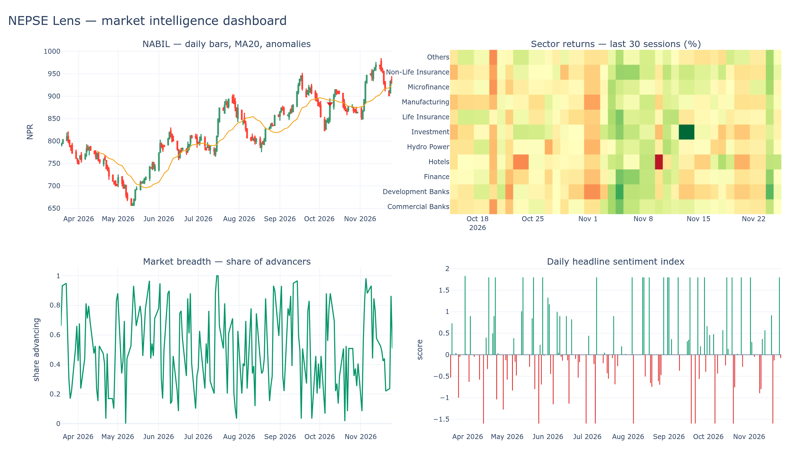

# NEPSE Lens

**Market intelligence for the Nepal Stock Exchange.** Ingestion, point-in-time features, anomaly detection, walk-forward direction models, financial-news sentiment, a FastAPI service, and a Streamlit dashboard.

[](https://github.com/sarvkk/nepse-lens/actions/workflows/ci.yml)




---

> **Demo status:** This is a reproducible portfolio project, not a live trading or investment system. Its prices and anomaly labels are synthetic. The live NEPSE client exists, but real deployment needs a stable token source and historical backfill.

## Why this exists

NEPSE does not offer a clean public API or open daily dataset. Much retail analysis happens in forum threads and screenshots. The missing tooling is the interesting part: messy ingestion, point-in-time features, anomaly triage, and turning financial text into a signal that can be plotted.

NEPSE Lens is an end-to-end pipeline rather than a notebook. Each stage is a module with tests. Evaluation uses walk-forward splits, and the result is an API and dashboard, not one chart.

---

## What it does

| Stage | Implementation |
| --- | --- |
| **Ingest** | Live NEPSE client (`Authorization: Salter` token, retries, raw JSON archive) or a bundled deterministic fixture snapshot. |
| **Store** | DuckDB single-file warehouse. Idempotent upserts; no server to run. |
| **Features** | Returns, rolling volatility, volume/turnover z-scores, MA gap, RSI, intrabar range, gap, market breadth — all point-in-time. |
| **Anomaly detection** | Robust z-score, Isolation Forest, and an optional LSTM autoencoder. Fitted detectors train on the first half of sessions and are scored on the second half. |
| **Direction** | Next-session up/down with a naive prior, logistic regression, and histogram gradient boosting, evaluated on an expanding walk-forward split. |
| **NLP** | Finance-tuned lexicon baseline plus an optional FinBERT path; evaluated on templated headlines and on Financial PhraseBank. |
| **Serve** | FastAPI (`/ohlcv`, `/anomalies`, `/sentiment`, `/predictions`, `/market/summary`) and a Streamlit dashboard. |
| **Ship** | Docker, docker-compose, GitHub Actions (ruff + pytest + full pipeline), 53 tests, model card, reproducible `make` targets. |

---

## Results

The headline numbers below come from the bundled 59-symbol, 760-session fixture and, where noted, Financial PhraseBank. Run `make train-full` to reproduce the full table. `make train` reproduces the fixture-backed pipeline and templated-headline metrics, but does not evaluate PhraseBank.

**Next-session direction — expanding walk-forward, 5 folds, no shuffling**

| Model | Accuracy | ROC AUC | Brier |
| --- | ---: | ---: | ---: |
| `naive_prior` | 51.8% ± 3.1% | 0.500 | 0.250 |
| `logistic` | 52.6% ± 2.2% | 0.532 | 0.250 |
| `hist_gbm` | **52.9% ± 1.8%** | 0.529 | 0.257 |

**Anomaly detection — 61 labelled events in the out-of-sample half (118 injected in total)**

| Detector | Precision@k | Recall@k | Lift@k | Avg precision |
| --- | ---: | ---: | ---: | ---: |
| `robust_zscore` | 55.7% | 55.7% | 205× | 0.553 |
| `isolation_forest` | 96.7% | 96.7% | 355× | 0.996 |

**Headline sentiment**

| Dataset | Model | Accuracy | Macro F1 | n |
| --- | --- | ---: | ---: | ---: |
| Templated NEPSE headlines | finance lexicon | 95.2% | 0.953 | 3,491 |
| Financial PhraseBank (all-agree) | finance lexicon | 73.1% | 0.602 | 2,264 |

> **Read the caveats.** The price fixture is synthetic and includes a small AR(1) component used to validate the walk-forward harness. The 1.1-point lift over the naive prior proves that the pipeline runs. It does not show a tradeable edge. Injected anomaly labels also make anomaly scores easier to recover than they would be on real events. The most useful NLP result is the lexicon's 73.1% accuracy on real Financial PhraseBank sentences. FinBERT reaches 97.2% on PhraseBank, but it was fine-tuned on that dataset. Treat 97.2% as an upper bound, not a benchmark. See [MODEL_CARD.md](MODEL_CARD.md).

---

## Quickstart

```bash
git clone https://github.com/sarvkk/nepse-lens.git
cd nepse-lens

python -m venv .venv && source .venv/bin/activate
pip install -e ".[dev]"

make train     # generate fixture → features → models → reports
make dash      # http://localhost:8501
make api       # http://localhost:8000/docs
```

`make train` writes `reports/metrics.json` and `reports/report.md`. The database lands in `data/nepse.duckdb` and is regenerable. To reproduce the PhraseBank numbers in this README:

```bash
make train-full   # fetches Financial PhraseBank, then trains with it
make preview      # re-renders docs/preview.png (needs kaleido + Chrome)
```

### Optional extras

```bash
pip install -e ".[torch]"   # LSTM autoencoder
pip install -e ".[nlp]"     # FinBERT (downloads ~440 MB)
python scripts/train.py --torch --phrasebank data/external/FinancialPhraseBank-v1.0/Sentences_AllAgree.txt
python scripts/evaluate.py --model finbert   # in-sample upper bound; see caveat above
```

### Docker

```bash
docker compose up --build
# dashboard → http://localhost:8501
# api       → http://localhost:8000/docs
```

---

## Data: live vs fixture

NEPSE's Angular frontend mints a short-lived `Salter` bearer token for every JSON call. There is no stable public token endpoint, so live mode asks you to supply one:

```bash
cp .env.example .env
# paste the Authorization header value from DevTools into NEPSE_TOKEN
python scripts/fetch_data.py --source live
```

`config.py` loads `.env` automatically (real environment variables still win), so the same token works for the CLI, the API, and the dashboard.

Live mode archives every raw payload under `data/raw/` before normalising, so a schema change never destroys the original response. Because a single snapshot is not enough for features, a real deployment would run this on a schedule and backfill history.

CI and the demo use `--source fixture` instead: a deterministic, NEPSE-shaped snapshot with 59 tickers, eleven sectors, fat-tailed returns, volume that co-moves with absolute return, and labelled anomaly events. It is checked in under `data/fixtures/` so the repository is reproducible without credentials.

---

## Evaluation discipline

The two things that make market ML look better than it is are leakage and random K-fold. This repo blocks both:

- `tests/test_features.py::test_no_future_leakage` multiplies the last five sessions by 3× and asserts that every feature on or before the cutoff is byte-identical.
- `tests/test_features.py::test_target_matches_next_close` checks the label is exactly `close[t+1] > close[t]`.
- `walk_forward_splits` is expanding-window and strictly ordered; the test asserts each test block starts after the previous one ends.
- Sentiment is evaluated on human labels (PhraseBank), not on the templates the lexicon was tuned against.

---

## Architecture

```
 NEPSE API ──┐
             ├──► ingest ──► DuckDB ──► features ──┬──► anomaly detectors ──┐
 fixture CSV ┘                                      ├──► direction models ───┤
                                                    └──► headline sentiment ─┤
                                                                             ▼
                                                        reports/ + FastAPI + Streamlit
```

```
src/nepse_lens/
├── config.py            # env-overridable paths and settings
├── store.py             # DuckDB schema + idempotent upserts
├── ingest/
│   ├── client.py        # live NEPSE client (token, retries, raw archive)
│   └── fixtures.py      # deterministic NEPSE-shaped snapshot
├── features.py          # point-in-time feature engineering
├── models/
│   ├── anomaly.py       # robust z, Isolation Forest, LSTM-AE
│   ├── direction.py     # walk-forward evaluation
│   └── torch_models.py  # optional LSTM-AE + TCN
├── nlp/
│   ├── lexicon.py       # finance vocabulary, negators, intensifiers
│   ├── sentiment.py     # scoring + FinBERT
│   └── phrasebank.py    # benchmark loader
├── pipeline.py          # orchestration
├── report.py            # markdown metrics report
├── api.py               # FastAPI
└── dashboard.py         # Streamlit
```

---

## Design decisions

**DuckDB over Postgres.** One file, analytical SQL, no container to babysit. The whole store is 13 MB and rebuilds in seconds.

**Fixture-first.** A portfolio project that only runs with a private token is not reproducible. The fixture is the default; live mode is opt-in and documented.

**Optional heavy dependencies.** PyTorch and transformers are extras. The core pipeline and CI install in under a minute, which keeps the feedback loop honest.

**Honest metrics over impressive ones.** The direction model is barely better than the base rate, and the README says so. A reviewer who sees a 92% accuracy claim on daily equity direction should assume leakage; showing the walk-forward harness and the base rate is the stronger signal.

**Anomaly labels are injected, and labelled as such.** Precision@k measures whether the detector recovers known events, not whether those events predict returns.

---

## What I'd do next

- **Real history.** Scheduled ingestion with a multi-year backfill, corporate-action adjustment, and a data-quality report (missing sessions, zero-volume days, splits).
- **Better labels.** Replace injected events with hand-audited real events (circuit breakers, block deals, earnings surprises) and measure detector agreement with analysts.
- **FinBERT fine-tune.** Evaluate on a benchmark FinBERT was *not* trained on (FiQA, or a hand-labelled NEPSE set) before quoting a number; PhraseBank is contaminated for this model.
- **Cross-sectional model.** Predict relative rank within sector rather than absolute direction; that is closer to how a market-visualization product would surface "what moved and why."
- **Deployment.** Model registry, scheduled retrain, drift monitoring on feature distributions, and a proper dashboard auth layer.

---

## License

MIT for the code. Financial PhraseBank is **not** redistributed; `scripts/fetch_phrasebank.py` downloads it under CC BY-NC-SA 3.0 (Malo et al., 2014). Fixture data is synthetic.
